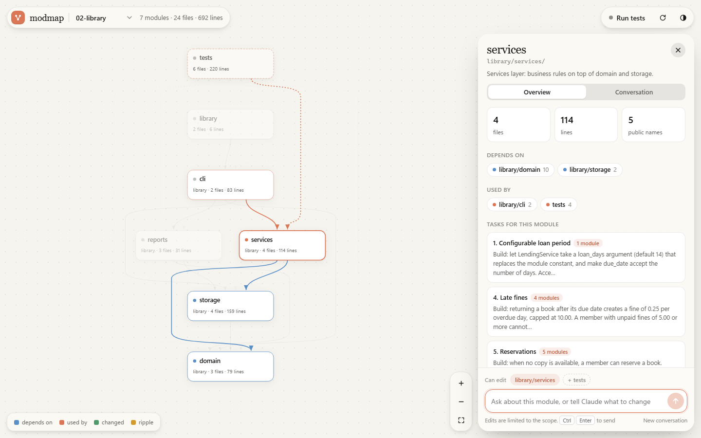

# modfence

**See your project as modules. Click one, and talk to Claude about that module only.**



modfence draws your Python project as a graph of modules and the imports between them. Click a module and a panel opens with:

- what is inside it: files, public names, its docstring;
- what it depends on, and what depends on it;
- a prompt box.

Your request goes to your own Claude Code, scoped to that module:

- **Claude can read the whole project, but can only edit the modules in the scope.** This is enforced by a hook, not just asked for in the prompt.
- **The answer streams into the panel.** It shows the text, plus each file Claude read or edited and each command it ran.
- **When it finishes, the graph shows what changed.**
  - Modules with changed files pulse green.
  - Modules that import them are marked amber: the ripple.
  - A change made outside the scope by a shell command is flagged in red.
- **Every module keeps its own conversation.** Opening the module again continues where you left off.

## Run it

```bash
cd modfence
python -m modfence                         # the three example projects
python -m modfence path/to/your/project    # or your own (one or more)
```

It opens `http://127.0.0.1:8765`.

**Requirements:** Python 3.10+, and a logged-in [Claude Code](https://code.claude.com) CLI. Runs use your own subscription or API setup, so modfence needs no API key of its own.

**Which Claude Code it uses:** the first one it finds of:
1. `CLAUDE_BIN`;
2. the newest binary bundled with the VS Code extension;
3. `claude` on your PATH.

modfence itself uses only the Python standard library and nothing is installed.

## Using it

| Do | How |
|---|---|
| Open a module | Click it. Its dependencies turn blue and its dependents clay; everything else fades. |
| Widen the scope | Shift-click more modules, or click `+ tests` above the prompt box. The scope is what Claude may edit. |
| Ask or instruct | Type in the prompt box. Send with `Ctrl` + `Enter` (or `Cmd` + `Enter`). The send button turns into stop while a run is going. |
| Follow an import | Hover an edge to see the exact import lines behind it; click to open the file at that line. |
| Pick an exercise | If the project has a `TASKS.md`, tasks that target the open module appear in its Overview. Clicking one fills in the prompt and sets the scope to the modules the task names. |
| Check the result | Click `Run tests` (runs `python -m unittest discover -s tests -t .`). Click the toast for the full output. |
| Start over | `New conversation` drops this scope's session and history. |
| Move around | Drag to pan, pinch or `Ctrl` + scroll to zoom, double-click to fit. |
| Link to a module | `http://127.0.0.1:8765/#p=1&m=library/services` opens project 1 with that module selected. |

## The example projects

[`examples/`](examples/) holds three small modular projects, from easy to hard. Each has tests and a `TASKS.md` with five exercises, from single-module to cross-module:

| Project | Modules | What it teaches |
|---|---|---|
| `01-calculator` | lexer, parser, evaluator, cli | a pipeline: each stage depends only on the one before it |
| `02-library` | domain, storage, services, reports, cli | layers: the domain depends on nothing, and the CLI sits on top |
| `03-spreadsheet` | cells, formula, functions, graph, engine, io, cli | an engine that composes four independent modules |

The cross-module tasks are where the scope pays off. Here is what happened with the scope set to `calc/evaluator` only, asking for the `^` operator, which also needs the lexer and parser:

- Claude implemented and tested the evaluator part.
- It listed the exact changes `calc/lexer` and `calc/parser` still need.
- It did not touch them.

In a separate check, asked to write a file in `calc/lexer` with the same scope, the write was blocked by the hook.

## How it works

| Part | File | What it does |
|---|---|---|
| Graph | `modfence/analyze.py` | Parses every `.py` file with `ast`. A module is a directory. An edge A → B exists when a file in A imports a file in B (absolute and relative imports). Each edge keeps its receipts: the file, line and source of every import behind it. No model draws the graph. |
| Runs | `modfence/runner.py` | Starts `claude -p --output-format stream-json --include-partial-messages` in the project root. It adds a system note naming the scope, its files and public names, and what it depends on and is used by. It resumes the scope's previous session. After the run it diffs the project to report changes, edits outside the scope, and the ripple. |
| Scope | `modfence/scope_guard.py` | A `PreToolUse` hook, passed with `--settings` for that run only. It denies `Edit`, `Write`, `MultiEdit` and `NotebookEdit` on any path outside the scope. `..` tricks and symlinks are resolved first. It fails closed. |
| Server | `modfence/server.py` | `http.server` on 127.0.0.1 only. Events stream to the page as server-sent events. The page itself is plain HTML, CSS and JS with no build step, in `modfence/web/`. |

**State** lives in `<project>/.modfence/` (git-ignored automatically): session ids and conversation history per scope. Browsing a project never writes to it; only a run does.

**Security:**
- The server only answers requests whose `Host` is `127.0.0.1` or `localhost`.
- Every state-changing request needs an `X-Modfence` header, which a page on another site cannot send.
- Another website therefore cannot drive your Claude Code through modfence.
- File views are confined to the project folder.

## Limits

- **Python only.** JS/TS imports are not analyzed yet.
- **A module is a directory.** Projects that keep everything in one folder show up as a single module.
- **The hook sees the file tools, not shell commands.** A script that writes files can still change something outside the scope. modfence reports it after the run as "changed outside the scope", but does not prevent it. Runs only allow `python` and read-only `git`/`ls`/`cat` commands without asking.
- **Runs use your Claude Code settings**, including your own CLAUDE.md, so the answer follows your usual preferences.
- **One run at a time per project.**

## Tests

```bash
python -m unittest discover -s tests -t .
```

The suite has 15 deterministic tests. No model is called: `tests/fake_claude.py` stands in for the CLI. It emits Claude Code's stream-json events and makes the file edits the prompt asks for.
