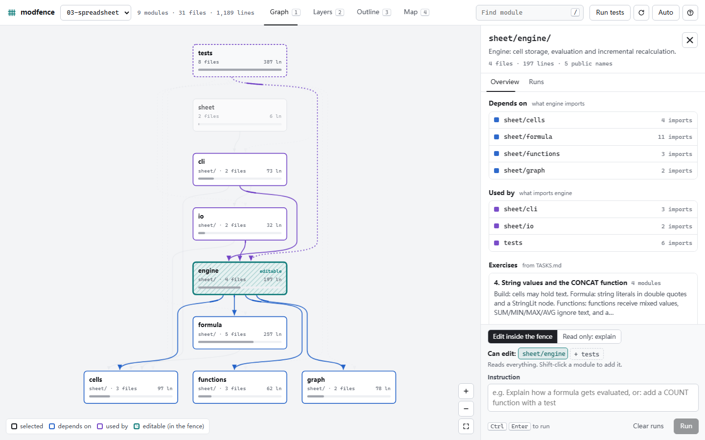
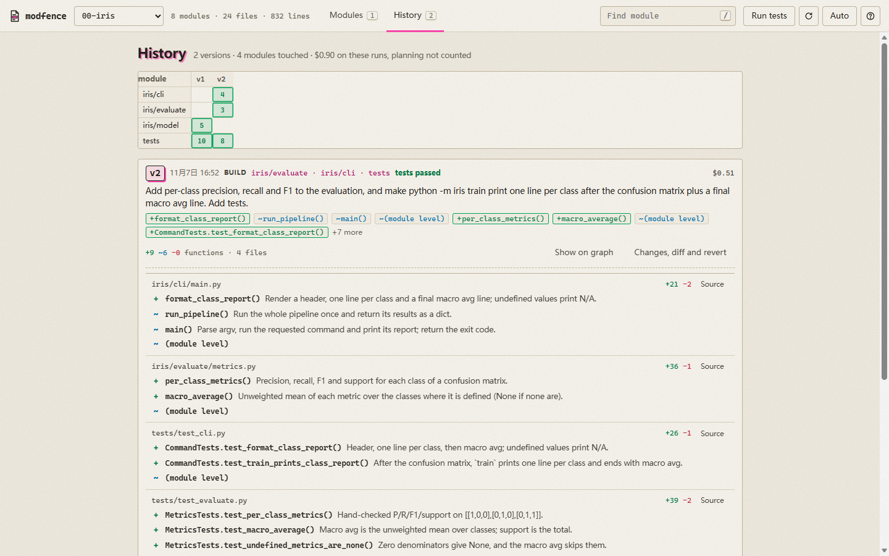
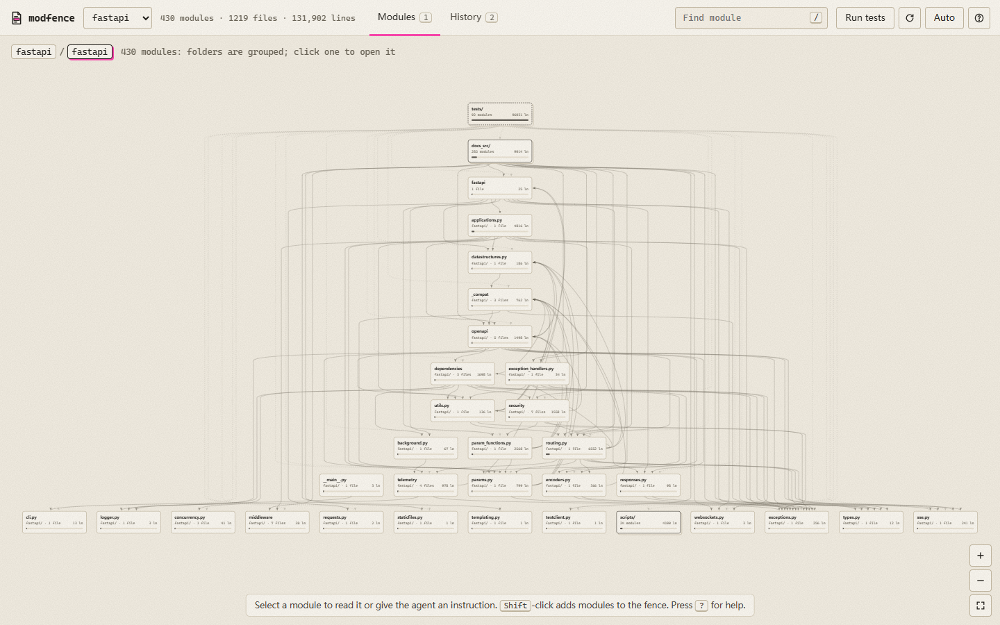

<h1 align="center"></h1>

**Understand your project as modules, then direct the AI module by module.** modfence draws your code as the roles the system plays and the parts inside them, and every box is something you can hand the agent as its fence. Design rules: [docs/GOLDEN_RULES.md](docs/GOLDEN_RULES.md).



Tools that draw a repository's structure help you read it. modfence is for changing it with an AI agent without losing track of your own project. You work in **fence coding**:

1. **Pick the box.** Zoom from the system's roles to a role's parts (below). Select a box: its card says what it does; *Ask / edit* makes it the fence.
2. **Agree on a plan.** The agent reads the project (it cannot edit yet), asks up to four questions with its recommended answer preselected, and lists the functions it will add, change or remove. You answer and press *Build*.
3. **Build inside the fence, sealed.** A hook blocks every edit outside the fence. By default the run is also sealed: the agent cannot read other modules' code, only a short brief of what they offer and what the fence must keep working (built from the import graph, no model call; a whole role of a 581-file system is 0.3k-3.4k tokens). It cannot lean on or break their internals. *Sealed* in the fence line turns this off for one run. Measured on rich (100 files): naming the module cut cost 19% against asking with the task alone; the seal added about 5% on these small tasks and saved nothing there, since no agent read other modules anyway. It is on for safety, not tokens ([Evaluation, section 5](docs/EVALUATION.md#5-the-ai-only-brief-sealed-runs-and-contracts-golden-rules-1-3-4)). Before the agent may stop, the project's tests run; if they fail it is sent back once.
4. **Review the version.** Every run that changed code becomes a numbered version in **History**: what you asked, which modules and functions changed, whether the tests passed, the cost, the diff, and a revert.



## Two levels: what the system does, and the parts of each role

Reading code line by line was the human engineer's way in. With an agent writing the lines, what you need is the shape: which part does what, and which parts talk to each other. modfence gives you that at two levels, and every box is also a fence you can hand the agent. Function-level graphs were tried and removed: nobody wants to read them.

| Level | You see | On the card | Fence |
|---|---|---|---|
| **1 Areas** | At most 7 boxes, always: groups of roles that change together (git history), import each other and share folders, no area over 40% of the code, then grouped and named by one model call with that as evidence (`roles.propose_areas`; measured in [EVALUATION section 6](docs/EVALUATION.md)). Entry points (`main`, `*_main`), HTTP route files and shared config (`settings`, `config` used by 2+ roles) are not boxes: the side bar lists them under the role that starts, serves or reads them, read-only by default. Lines: imports (solid); HTTP calls and started files (dashed, `roles.runtime_links`: a URL path matched to a route decorator, a file named by path); copied code (dash-dot: same file name in another top folder, half its lines shared); and, for a box with no other link, the box it most often changed with in git (dotted, with the commit count). Every box has at least one line when any of these exists. | *Open roles*, *Ask / edit* | the area's files, without entry points, doors and shared config (read-only by default) |
| **2 Roles of an area** | Roles in other areas that these link to are drawn faded, labelled with their area. What the system does: observer, segmenter, inference, memory ... At most 15 roles, none over 25% of the files: folder and file-name groups merged by what changed together in git, what imports what and shared folders, small groups first; one small model call only names them ([EVALUATION section 7](docs/EVALUATION.md)). HTTP route files count as *doors* of the role they serve. Areas, roles and parts are drawn with a stress layout (boxes that import each other sit close, imports point roughly down) and every import is shown, thicker for more import lines and faint when weak; a two-way import is a pair of parallel lines. After each run the boxes it changed turn green with +/- lines, boxes that use changed code turn pale yellow, and a line above the map names them (golden rule 7). A role can move to another area from its card. | *Open parts*, *Ask / edit* | the role's files, without doors (read-only by default) |
| **3 Parts of a role** | Only the role's own parts, at most 8: files grouped by the word their names share (all `*_round` files), else by folder; a role of 8 files or fewer shows its files. Lines are the imports between parts. Imports to other roles are counted, not drawn. | *Ask / edit* | the part's files |

**Where roles come from.** On a project with more than 12 modules, the first open groups the files by folder and splits big flat folders by the words in their file names (deterministic), then one Haiku call (about one cent) maps those groups onto 6-15 roles named in the project's own words. A file moves between groups only if its imports back it. You then rename roles, move files and confirm (*Files*, *Rename*, *Confirm roles*); roles keep a stable id, so a rename never changes which files they hold, and new files wait under "not placed yet". Names are checked: at most 3 words and 24 characters, and no two alike. This method was chosen out of nine by measurement: see [Evaluation, section 4](docs/EVALUATION.md#4-grouping-files-into-roles).

## Run it

```bash
pip install git+https://github.com/ruijiezh67/modfence
cd path/to/your/project
modfence
```

It opens `http://127.0.0.1:8765` on the current directory. `modfence a b` opens several projects; To try the bundled examples from a clone of this repo: `python -m modfence examples/*`.

**Requirements:** Python 3.10+ and a logged-in [Claude Code](https://code.claude.com) CLI. Runs use your own Claude subscription or API setup; modfence has no API key and no dependencies.

**Tests for the done check:** pytest if the project is configured for it (`conftest.py`, `pytest.ini`, or `[tool.pytest...]`), else `unittest` on `tests/` or `test/`, using the project's `.venv` if it has one. Override with `modfence --test-cmd "pytest -q tests/unit"`. A suite that takes longer than 270 s is not used to block the agent.

## Big projects

- **Roles first.** Above 12 modules the project opens at its roles (see above); *All modules* shows the module graph.
- **Folders fold.** In the module graph, a project with more than 60 modules opens as its top folders (fastapi: 430 modules as 4 folders). Select a folder, then *Open folder*; the path at the top goes back. Search (`/`) finds any module and opens the folders down to it.
- **Fast after the first scan.** Parsed files and file hashes are cached by size and modification time. Measured on a laptop: fastapi (1,219 Python files) scans and snapshots in 1.6 s once cached (8.9 s for the first scan; 61 s right after cloning, when the disk cache is cold too); pydantic (3,155 files) in 2.2 s (11.8 s first scan).
- **Revert is kept for the fence.** Before a run, modfence keeps a copy of up to 50 MB of the project's files, and always of the fenced modules' files, so the run can be undone.



## The example: an ML pipeline in six modules

[`examples/00-iris`](examples/00-iris/) trains a classifier on Fisher's Iris data with the standard library only: `data` (load, stratified split), `features` (standardize), `model` (softmax regression), `train` (gradient descent), `evaluate` (accuracy, confusion matrix), and `cli`, which runs them in that order. 34 tests run in about a second; `python -m iris train` prints test accuracy 0.9778. Its `TASKS.md` has five exercises, from one module (a k-NN model) to several (save and load as JSON: `model` + `cli`).

The two versions in the History screenshot are real runs on it (Claude Code 2.1.319, 2026-11-07):

| Version | Fence | Plan | Build | Done check | Functions |
|---|---|---|---|---|---|
| v1 k-NN classifier | `iris/model`, `tests` | $0.23 | $0.39 | passed, 43 tests | +5 in `knn.py`; +10 in tests |
| v2 precision, recall, F1 | `iris/evaluate`, `iris/cli`, `tests` | $0.25 | $0.51 | passed, 49 tests | +3 and ~4 in code; +6 in tests |

[`examples/`](examples/) also holds a calculator (a pipeline), a library system (layers), a spreadsheet engine, and a PyTorch tinygpt (needs `torch`).

## Using it

| Do | How |
|---|---|
| Find a module | `/` or `Ctrl` + `K`, then type. |
| Switch view | `1` Modules, `2` History. |
| Read a module | Click a box: a card shows what it is, with *Open functions* (its call graph) and *Ask / edit* (the panel). What it uses turns blue, the modules that use it orange. Its functions are listed with what each does: the docstring, or a one-line summary by a small model (Haiku), cached until the file changes and marked `AI`. Source files are folded away under *Source files*. |
| Set the fence | The selected module is editable (pink). Shift-click adds modules; `+ tests` adds the tests. *Explain* fences nothing and skips the plan. |
| Instruct | Type (click a function to mention it), press *Plan* or `Ctrl` + `Enter`. Answer, press *Build*. The bar at the top shows the running agent, with Stop. |
| Review | The run's functions appear in the panel; every run is also a version in History. *Show on graph* paints the modules it changed (green) and those that use them (yellow). *Changes, diff and revert* opens the functions, the line diff, and the revert. |
| Link | `http://127.0.0.1:8765/#p=0&m=iris/evaluate` opens a module. |

## Engineering standards

[`docs/STANDARDS.md`](docs/STANDARDS.md) lists the rules modfence takes from git's contribution guidelines, Google's code review practices, Anthropic's Claude Code best practices and others, and for each one whether modfence does it and which test shows it. In short: plan first, a harness-enforced pass/fail check, edits blocked outside the fence, every change reviewable by function and reversible. Not yet: size warnings, test-first mode, commit messages from runs.

## How it works

| Part | File | What it does |
|---|---|---|
| Graph | `modfence/analyze.py` | Parses every `.py` file with `ast`. A module is a directory; in flat code each root `.py` file, and each file in a directory with 8 or more `.py` files of its own, is a module. An edge A → B exists when a file in A imports a file in B, and keeps the file, line and imported name of each import. Functions are top-level functions, classes, methods and UPPER constants; a run's changes are named by fingerprinting each one before and after. No model draws the graph. |
| Purposes | `modfence/purpose.py` | The docstring's first line, else a summary from `claude -p --model haiku` with no tools and without your settings or CLAUDE.md. $0.0004 to $0.002 and about 10 s per module on the examples. Cached in `.modfence/purposes.json` by file hash. |
| Runs | `modfence/runner.py` | Plan runs are read-only and answer with JSON (questions and the plan); build runs resume that session. Each run starts `claude -p --output-format stream-json` with a note naming the fence, its public names, and its neighbours with file:line receipts. After the run it diffs the project, names changed functions, finds the modules that use changed code, and stores the before and after of each file. |
| Fence | `modfence/scope_guard.py` | A `PreToolUse` hook for that run only: denies `Edit`, `Write`, `MultiEdit` and `NotebookEdit` outside the fence, after resolving `..` and symlinks. Fails closed. While the UI has a fence set it is also written to `.modfence/fence.json` and the hook to `.claude/settings.local.json` (your keys and hooks kept; removed on revert, clear or server exit). |
| Done check | `modfence/done_check.py` | A `Stop` hook on build runs: runs the tests, blocks the first stop on failure, lets the second through and marks the version "tests failed". |
| Server | `modfence/server.py` | `http.server` on 127.0.0.1 only; plain HTML, CSS and JS in `modfence/web/`, no build step. Requests must carry a localhost `Host`; writes need an `X-Modfence` header, so another website cannot drive your Claude Code. |

**State** lives in `<project>/.modfence/` (git-ignored automatically): sessions and run logs per fence, `runs/<id>/` with each version's files before and after, and `purposes.json`.

## Limits

- **Python only.** JS/TS imports are not analyzed yet.
- **Agents you start yourself are fenced too, untested live.** While a fence is set, the hook also applies to Cursor, GitHub Copilot, Devin, Codex or Claude Code started by hand in the project, and denies an unknown tool whose name says it changes files. Only the payload shapes are unit-tested; behaviour inside those agents is N/A (not run).
- **The hook sees the file tools, not shell commands.** A script can still write outside the fence; modfence reports it after the run and offers a revert. Runs allow only `python` and read-only `git`/`ls`/`cat` without asking.
- **Runs use your Claude Code settings**, including your CLAUDE.md (the plan's questions come in your chat language). Function summaries do not.
- **"Used by" per function** counts `from x import name`; `import x` then `x.f()` is not traced to the function.
- **Plan + build is not benchmarked yet.** One calculator run cost $0.76 against $0.51 for a fenced run without a plan; n = 1, so the comparison is N/A.
- **Roles are a proposal.** Measured on one 400-file system against its docs, the proposal agrees with them at ARI 0.61 (1 = identical). Expect to move files.
- **One run at a time per project.** The thresholds (12 modules for roles, 8 parts per role, 60 for folding, 3 links per box) are fixed.

## Evaluation

On four cross-module features, fencing the modules a feature needs (tests included) built every feature correctly at 21% lower cost, 37% less context re-read and 27% less time than handing the whole task to Claude Code, cheaper on each of the four (n = 2 each, so suggestive). [`docs/EVALUATION.md`](docs/EVALUATION.md) has the method, the numbers, and the analyzer on popular repositories; scripts in [`bench/`](bench/).

## Tests

```bash
python -m unittest discover -s tests -t .
```

35 deterministic tests. No model is called: `tests/fake_claude.py` stands in for the CLI, emitting Claude Code's stream-json events and making the edits the prompt asks for.
