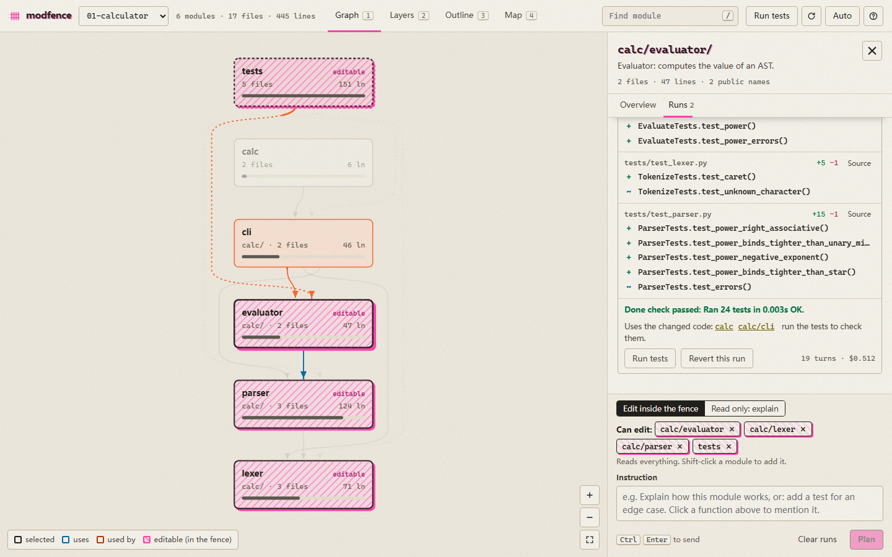

# modfence

**See your project as modules and functions. Fence what an AI agent may edit. Plan, build, and review every function it changed.**


modfence is a tool for **fence coding**: working with an AI agent on a codebase you read as modules and functions instead of lines. Vibe coding hands the agent the whole repo and a wish. Fence coding asks a little more of you first: you say which modules may change, settle the open questions, and agree on what "done" means. In return the agent explores less, and every change comes back as a list of functions you can check.

It draws your Python project as modules and the imports between them. Select a module and a panel opens with:

- **its functions**, each with one line on what it does: the author's docstring, or, where there is none, a summary written by a small model (Haiku) the first time you open the module and cached until the file changes (marked `AI`);
- what it uses and who uses it, by name (`parser uses tokenize, Token from lexer`);
- exercises from the project's `TASKS.md` that touch it;
- the fence, and an instruction box. Click a function to mention it in the instruction.

The source files are one click further, under *Source files*, for whoever wants them.

Your instruction goes to your own Claude Code:

- **An edit starts with a plan.** The agent reads the project (it cannot edit yet), asks up to four questions with its recommended answer preselected, and lists the functions it will add, change or remove. You answer and press *Build*; the build resumes the same session, so nothing the planner read is read again.
- **The agent reads the whole project but edits only inside the fence.** A hook enforces this; the prompt does not just ask for it.
- **A done check before it may finish.** A `Stop` hook runs the project's tests. If they fail, the agent is sent back once with the output; a second failure is let through and the run is marked "done check failed", so it cannot loop and burn tokens.
- **Read only mode** fences nothing and skips the plan: the agent explains and gives hints instead of solutions.
- **Each run ends with the functions it touched:** added, changed or removed, with what each one now does. The line diff is behind *Source*. You can revert the run; a file you edited again since the run is left alone.
- **The graph shows the effect.** Changed modules get green dots and a `+n −m` badge. Modules that use changed code turn yellow. Files changed outside the fence get a red banner and a one-click revert.




## Run it

```bash
cd modfence
python -m modfence                         # the four example projects
python -m modfence path/to/your/project    # or your own (one or more)
```

It opens `http://127.0.0.1:8765`.

**Requirements:** Python 3.10+, and a logged-in [Claude Code](https://code.claude.com) CLI. Runs use your own subscription or API setup, so modfence needs no API key of its own.

**Which Claude Code it uses:** the first one it finds of:
1. `CLAUDE_BIN`;
2. the newest binary bundled with the VS Code extension;
3. `claude` on your PATH.

modfence itself uses only the Python standard library and nothing is installed.

## Using it

| Do | How |
|---|---|
| Find a module | Press `/` or `Ctrl` + `K` and type. Or click it in any view. |
| Switch view | `1` Graph, `2` Layers (architecture bands), `3` Outline (the project as a document), `4` Map (area is lines of code). Selection, fence and change marks carry across views. |
| Read a module | What it uses turns blue and the modules that use it orange; everything else fades. Its functions are listed with what each does; hover an arrow to see which names it carries. |
| Set the fence | The selected module is editable (pink, hatched). Shift-click adds modules; `+ tests` adds the tests. Switch to `Read only: explain` to fence nothing. |
| Give an instruction | Type it (click a function to mention it) and press *Plan* or `Ctrl` + `Enter` (`Cmd` + `Enter`). Answer the plan's questions and press *Build*. The bar under the top bar shows the running agent from any view, with Stop. While it runs, the fence border marches. |
| Pick an exercise | Exercises from `TASKS.md` that touch the module appear in its Overview. Clicking one fills in the instruction and fences the modules it names, plus the tests. |
| Review | In the Runs tab: the functions each run changed, *Source* for the line diff, `Revert this run`, `Run tests`. |
| Start over | `Clear runs` drops this fence's agent session and run history. Files are not touched. |
| Move around | Drag to pan, pinch or `Ctrl` + scroll to zoom, double-click to fit. The panel is resizable. `?` opens the help. |
| Link to a module | `http://127.0.0.1:8765/#p=1&m=library/services` opens project 1 with that module selected. |

## The example projects

[`examples/`](examples/) holds four small modular projects, from easy to hard. Each has tests and a `TASKS.md` with five exercises, from single-module to cross-module:

| Project | Modules | What it teaches |
|---|---|---|
| `01-calculator` | lexer, parser, evaluator, cli | a pipeline: each stage depends only on the one before it |
| `02-library` | domain, storage, services, reports, cli | layers: the domain depends on nothing, and the CLI sits on top |
| `03-spreadsheet` | cells, formula, functions, graph, engine, io, cli | an engine that composes four independent modules |
| `04-tinygpt` | config, data, model, train, eval, cli | a PyTorch training codebase: a character-level GPT that trains on a CPU in seconds. Needs `torch`. |

The cross-module tasks are where the fence pays off. Here is what happened with the fence set to `calc/evaluator` only, asking for the `^` operator, which also needs the lexer and parser:

- Claude implemented and tested the evaluator part.
- It listed the exact changes `calc/lexer` and `calc/parser` still need.
- It did not touch them.

In a separate check, asked to write a file in `calc/lexer` with the same fence, the write was blocked by the hook.

## How it works

| Part | File | What it does |
|---|---|---|
| Graph | `modfence/analyze.py` | Parses every `.py` file with `ast`. A module is a directory, except where code is flat: each `.py` file at the project root (`train.py`, `model.py`), and each file in a directory with 8 or more `.py` files of its own (`nanochat/gpt.py`), is a module by itself. An edge A → B exists when a file in A imports a file in B (absolute and relative imports). Each edge keeps its receipts: the file, line, source and imported name of every import behind it. The functions of a module are its top-level functions and classes and their methods; a run's changes are named by comparing a fingerprint of each one before and after. No model draws the graph. |
| Purposes | `modfence/purpose.py` | One line per function: the docstring's first line, else a summary from `claude -p --model haiku` with no tools, the user's settings and CLAUDE.md left out, and a two-sentence system prompt instead of Claude Code's own. The module's source is in the prompt. Measured on the examples: $0.0004 to $0.002 and about 10 s per module. Cached in `.modfence/purposes.json` by file hash. |
| Done check | `modfence/done_check.py` | A `Stop` hook added to build runs: it runs the project's `unittest` suite, blocks the first stop if it fails, lets the second through, and records each result for the run log. |
| Runs | `modfence/runner.py` | Starts `claude -p --output-format stream-json --include-partial-messages` in the project root. It adds a system note naming the fenced modules, their files and public names, and what they depend on and are used by. It resumes that fence's previous session. After the run it diffs the project to report changes, edits outside the fence, and the modules that import changed code. |
| Fence | `modfence/scope_guard.py` | A `PreToolUse` hook, passed with `--settings` for that run only. It denies `Edit`, `Write`, `MultiEdit` and `NotebookEdit` on any path outside the fence. `..` tricks and symlinks are resolved first. It fails closed. |
| Server | `modfence/server.py` | `http.server` on 127.0.0.1 only. Events stream to the page as server-sent events. The page itself is plain HTML, CSS and JS with no build step, in `modfence/web/`. Motion uses platform features only (View Transitions, `@starting-style`, scroll-driven animations, `::details-content`); older browsers get the same UI without the motion, and `prefers-reduced-motion` turns it off. |

**State** lives in `<project>/.modfence/` (git-ignored automatically): session ids and run history per fence, `runs/<id>/` with the before and after copy of every file a run changed (what diff and revert read), and `purposes.json` with the function summaries. Browsing a project writes nothing but those summaries.

**Security:**
- The server only answers requests whose `Host` is `127.0.0.1` or `localhost`.
- Every state-changing request needs an `X-Modfence` header, which a page on another site cannot send.
- Another website therefore cannot drive your Claude Code through modfence.
- File views are confined to the project folder.

## Limits

- **Python only.** JS/TS imports are not analyzed yet.
- **Large projects get large graphs.** Splitting flat directories into files keeps training repos useful (nanochat: 26 modules) but turns big libraries into big graphs (rich: 141 modules, fastapi with its docs examples: 430). There is no collapse or filter yet; use search (`/`) and the Layers view.
- **The hook sees the file tools, not shell commands.** A script that writes files can still change something outside the fence. modfence reports it after the run as "changed outside the fence" and offers a revert, but does not prevent it. Runs only allow `python` and read-only `git`/`ls`/`cat` commands without asking.
- **Runs use your Claude Code settings**, including your own CLAUDE.md, so the answer follows your usual preferences. Function summaries do not.
- **Function summaries cost a little and can be wrong.** They are written from the code by a small model, marked `AI`, and never replace a docstring. "Used by" per function counts `from x import name` only; a module imported whole (`import x` then `x.f()`) is not traced to the function.
- **The done check knows `unittest` only** (`tests/` folder). Projects without one get no done check.
- **Plan and build are new and not benchmarked yet.** The evaluation below measured single runs without a plan step; what the plan step costs and saves is N/A until it is measured.
- **One run at a time per project.**

## Evaluation

On four cross-module features, fencing the modules a feature needs (tests included) built every feature correctly at 21% lower cost, 37% less context re-read and 27% less time than handing the whole task to Claude Code, and it was cheaper on each of the four (n = 2 each, so suggestive). [`docs/EVALUATION.md`](docs/EVALUATION.md) has that benchmark, one against plain Claude Code and Claude Code's own permission rules, and the analyzer's numbers on popular open-source repos. The scripts are in [`bench/`](bench/).

## Tests

```bash
python -m unittest discover -s tests -t .
```

The suite has 24 deterministic tests. No model is called: `tests/fake_claude.py` stands in for the CLI. It emits Claude Code's stream-json events and makes the file edits the prompt asks for.
