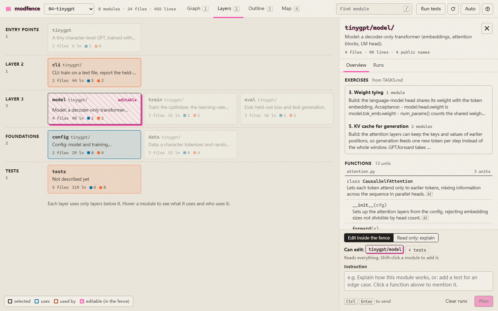

# modfence

**See your project as modules. Fence the ones an AI agent may edit. Review every change it made.**


modfence is for learning a codebase and practicing coding with an AI agent without losing track of what it did. It draws your Python project as modules and the imports between them. Select a module and a panel opens with:

- what is inside it: files, public names, its docstring;
- what it depends on and what uses it, with the exact import lines behind each arrow;
- exercises from the project's `TASKS.md` that touch it;
- the fence, and an instruction box.

Your instruction goes to your own Claude Code:

- **The agent reads the whole project but edits only inside the fence.** A hook enforces this; the prompt does not just ask for it.
- **Read only mode** fences nothing: the agent explains, points to `file:line`, and gives hints instead of solutions.
- **Each run is a log, not a chat:** the instruction, every file read or edited, every blocked edit and why, and the agent's notes.
- **Each run ends with a review table.** It lists every changed file with added and removed lines, and an inline diff. You can revert one file or the whole run; a file you edited again since the run is left alone.
- **The graph shows the effect.** Changed modules turn green with a `+n −m` badge. Modules that import changed code turn amber. Files changed outside the fence get a red banner and a one-click revert.



## Run it

```bash
cd modfence
python -m modfence                         # the three example projects
python -m modfence path/to/your/project    # or your own (one or more)
```

It opens `http://127.0.0.1:8765`.

**Requirements:** Python 3.10+, and a logged-in [Claude Code](https://code.claude.com) CLI. Runs use your own subscription or API setup, so modfence needs no API key of its own.

**Which Claude Code it uses:** the first one it finds of:
1. `CLAUDE_BIN`;
2. the newest binary bundled with the VS Code extension;
3. `claude` on your PATH.

modfence itself uses only the Python standard library and nothing is installed.

## Using it

| Do | How |
|---|---|
| Find a module | Press `/` or `Ctrl` + `K` and type. Or click it in any view. |
| Switch view | `1` Graph, `2` Layers (architecture bands), `3` Outline (the project as a document), `4` Map (area is lines of code). Selection, fence and change marks carry across views. |
| Read a module | Its dependencies turn blue and the modules that use it violet; everything else fades. Expand a row to see the import lines, and click one to open the file at that line. |
| Set the fence | The selected module is editable (teal, hatched). Shift-click adds modules; `+ tests` adds the tests. Switch to `Read only: explain` to fence nothing. |
| Give an instruction | Type it and press `Ctrl` + `Enter` (`Cmd` + `Enter`). The bar under the top bar shows the running agent from any view, with Stop. While it runs, the fence border marches. |
| Pick an exercise | Exercises from `TASKS.md` that touch the module appear in its Overview. Clicking one fills in the instruction and fences the modules it names. |
| Review | In the Runs tab: `Diff` per file, `Revert this run`, `Run tests`. |
| Start over | `Clear runs` drops this fence's agent session and run history. Files are not touched. |
| Move around | Drag to pan, pinch or `Ctrl` + scroll to zoom, double-click to fit. The panel is resizable. `?` opens the help. |
| Link to a module | `http://127.0.0.1:8765/#p=1&m=library/services` opens project 1 with that module selected. |

## The example projects

[`examples/`](examples/) holds four small modular projects, from easy to hard. Each has tests and a `TASKS.md` with five exercises, from single-module to cross-module:

| Project | Modules | What it teaches |
|---|---|---|
| `01-calculator` | lexer, parser, evaluator, cli | a pipeline: each stage depends only on the one before it |
| `02-library` | domain, storage, services, reports, cli | layers: the domain depends on nothing, and the CLI sits on top |
| `03-spreadsheet` | cells, formula, functions, graph, engine, io, cli | an engine that composes four independent modules |
| `04-tinygpt` | config, data, model, train, eval, cli | a PyTorch training codebase: a character-level GPT that trains on a CPU in seconds. Needs `torch`. |

The cross-module tasks are where the fence pays off. Here is what happened with the fence set to `calc/evaluator` only, asking for the `^` operator, which also needs the lexer and parser:

- Claude implemented and tested the evaluator part.
- It listed the exact changes `calc/lexer` and `calc/parser` still need.
- It did not touch them.

In a separate check, asked to write a file in `calc/lexer` with the same fence, the write was blocked by the hook.

## How it works

| Part | File | What it does |
|---|---|---|
| Graph | `modfence/analyze.py` | Parses every `.py` file with `ast`. A module is a directory, except where code is flat: each `.py` file at the project root (`train.py`, `model.py`), and each file in a directory with 8 or more `.py` files of its own (`nanochat/gpt.py`), is a module by itself. An edge A → B exists when a file in A imports a file in B (absolute and relative imports). Each edge keeps its receipts: the file, line and source of every import behind it. No model draws the graph. |
| Runs | `modfence/runner.py` | Starts `claude -p --output-format stream-json --include-partial-messages` in the project root. It adds a system note naming the fenced modules, their files and public names, and what they depend on and are used by. It resumes that fence's previous session. After the run it diffs the project to report changes, edits outside the fence, and the modules that import changed code. |
| Fence | `modfence/scope_guard.py` | A `PreToolUse` hook, passed with `--settings` for that run only. It denies `Edit`, `Write`, `MultiEdit` and `NotebookEdit` on any path outside the fence. `..` tricks and symlinks are resolved first. It fails closed. |
| Server | `modfence/server.py` | `http.server` on 127.0.0.1 only. Events stream to the page as server-sent events. The page itself is plain HTML, CSS and JS with no build step, in `modfence/web/`. Motion uses platform features only (View Transitions, `@starting-style`, scroll-driven animations, `::details-content`); older browsers get the same UI without the motion, and `prefers-reduced-motion` turns it off. |

**State** lives in `<project>/.modfence/` (git-ignored automatically): session ids and run history per fence, and `runs/<id>/` with the before and after copy of every file a run changed, which is what diff and revert read. Browsing a project never writes to it; only a run does.

**Security:**
- The server only answers requests whose `Host` is `127.0.0.1` or `localhost`.
- Every state-changing request needs an `X-Modfence` header, which a page on another site cannot send.
- Another website therefore cannot drive your Claude Code through modfence.
- File views are confined to the project folder.

## Limits

- **Python only.** JS/TS imports are not analyzed yet.
- **Large projects get large graphs.** Splitting flat directories into files keeps training repos useful (nanochat: 26 modules) but turns big libraries into big graphs (rich: 141 modules, fastapi with its docs examples: 430). There is no collapse or filter yet; use search (`/`) and the Layers view.
- **The hook sees the file tools, not shell commands.** A script that writes files can still change something outside the fence. modfence reports it after the run as "changed outside the fence" and offers a revert, but does not prevent it. Runs only allow `python` and read-only `git`/`ls`/`cat` commands without asking.
- **Runs use your Claude Code settings**, including your own CLAUDE.md, so the answer follows your usual preferences.
- **One run at a time per project.**

## Evaluation

[`docs/EVALUATION.md`](docs/EVALUATION.md) has the benchmark against plain Claude Code and Claude Code's own permission rules, and the analyzer's numbers on popular open-source repos. The scripts are in [`bench/`](bench/).

## Tests

```bash
python -m unittest discover -s tests -t .
```

The suite has 19 deterministic tests. No model is called: `tests/fake_claude.py` stands in for the CLI. It emits Claude Code's stream-json events and makes the file edits the prompt asks for.
